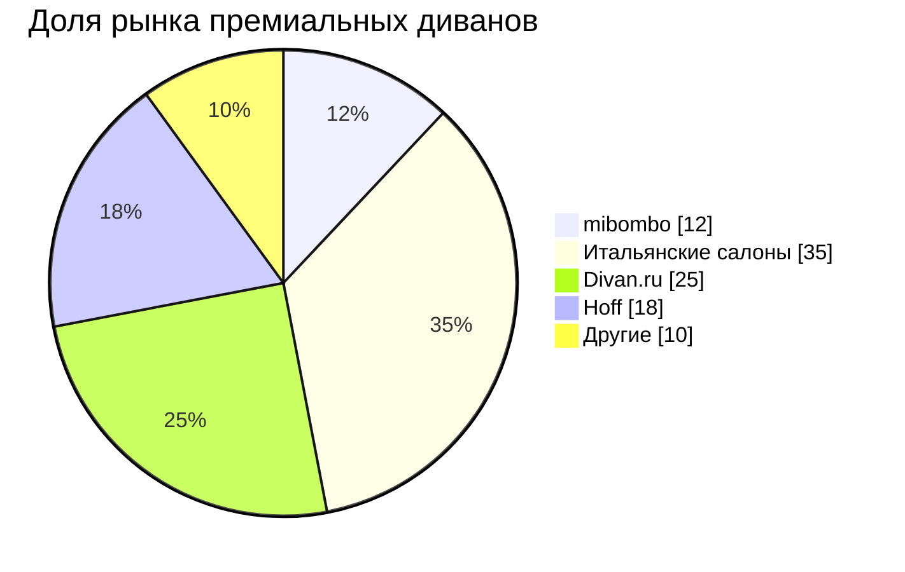

### Анализ конкурентной среды

Представленная диаграмма демонстрирует распределение долей рынка в сегменте премиальных итальянских диванов. Несмотря на то, что mibombo — относительно молодой игрок, мы уже занимаем уверенные **12% рынка**, успешно конкурируя с крупными федеральными сетями и классическими салонами.

---

--- 
### Что показывают цифры:
- **Итальянские салоны (35%)** — традиционные люксовые бутики. Они предлагают высочайшее качество, но зачастую с огромной наценкой за бренд и логистику.
- **[Divan.ru](https://divan.ru/)(25%)** — крупный маркетплейс. Выигрывают за счёт широкого охвата и рекламы, но предлагают в основном фабричный масс-маркет, а не эксклюзивную Италию.
- **Hoff (18%)** — масс-маркет. Доступные цены, но качество материалов и сборки значительно уступает премиум-сегменту.
- **mibombo (12%)** — наша ниша. Мы отвоевали эту долю благодаря идеальному балансу: **прямые контракты с итальянскими фабриками** (качество как у салонов) и **отсутствие переплат за посредников** (цена ближе к среднему сегменту).
- **Другие (10%)** — мелкие локальные магазины и частные мастера.

## Вывод
Потребители всё чаще выбирают «умный премиум». Клиенты готовы платить за настоящее итальянское качество и ручную работу, но не хотят переплачивать за пафос. Именно в этой точке пересечения комфорта, подлинности и разумной цены находится **mibombo**.